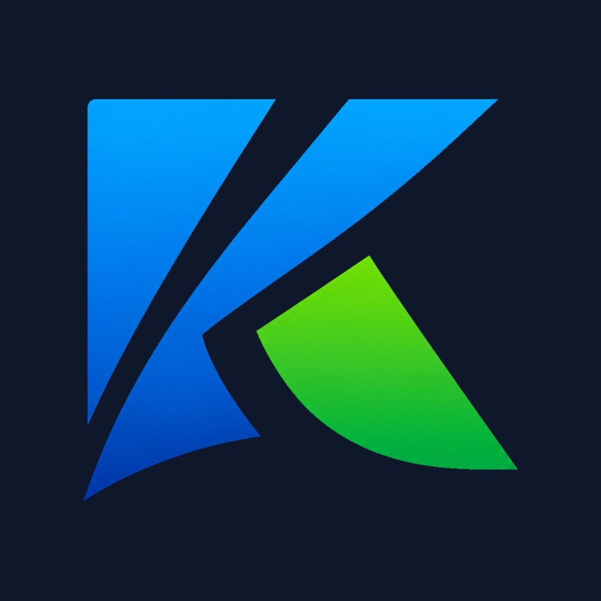

<h1 align="center">
  
  <br />
  Surfn Kiro
</h1>


&nbsp;&nbsp;&nbsp;&nbsp;

&nbsp;&nbsp;

---

**Surfn Kiro** is [Surfn](https://github.com/erikdubois/surfn) tuned to read well on every desktop, light and
dark, with KDE Plasma as the hardest case. It keeps Surfn's colourful look: same folders, same apps, same
categories. What changes is the small stuff Plasma draws on its own:

- Monochrome glyphs (panel, tray, symbolic and small action icons) follow Plasma's text colour, so they
  stay visible on light and dark. GTK desktops get a neutral mid grey that reads on both.
- White pages (the Defaults button and friends) have a thin grey outline, so they do not vanish on light.
- The sidebar Places icons (Home, Documents, Downloads, ...) are lifted from dark grey to mid grey.
- Icons that Plasma could not find (and silently replaced with a pencil) now exist.
- Paper's blend filter, which made 42 device icons blank in Plasma, is gone.

Unlike the other Surfn variants, Surfn Kiro is a **full** theme: it does not inherit from Surfn and does not
need `surfn-icons-git`. KDE shortens a missing icon name inside the theme before it asks an inherited theme,
so a thin overlay would show wrong icons.

## Installation (Arch / Kiro — nemesis_repo)

```bash
sudo pacman -S surfn-kiro-icons-git
```

## Manual

Copy `usr/share/icons/Surfn-Kiro` into `~/.icons` (or `~/.local/share/icons` on Plasma),
then select **Surfn Kiro** in your appearance settings.

## Credits

Built on Surfn by Erik Dubois, which itself blends Ultra Flat, Super Flat Remix, Yltra Flat, Numix (Circle)
and Paper icons. All credit to the original artists.

## License

[LICENSE](./LICENSE) — Attribution-NonCommercial-ShareAlike 4.0 International, the same as Surfn.
